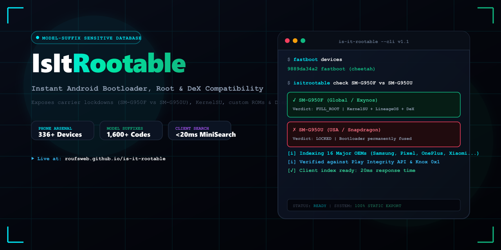

<div align="center">



# IsItRootable

**Model-Suffix Sensitive Android Bootloader Unlock, Root &amp; Hardware Compatibility Intelligence Platform**

[](LICENSE)
[](https://github.com/roufsweb/is-it-rootable/actions)
[](https://is-it-rootable.roufsweb.com/)
[](https://nextjs.org/)
[](https://www.typescriptlang.org/)
[](https://tailwindcss.com/)
[](https://is-it-rootable.roufsweb.com/)
[-627eea.svg?style=flat-square&logo=ethereum&logoColor=white)](https://etherscan.io/address/0x609e0AB78d5174F72fF8709564f8337DebEa5BD7)

</div>

> **Support the Project:** If IsItRootable helped you avoid a carrier lockout or save hours of research, feel free to buy a coffee via Ethereum / MetaMask:  
> `0x609e0AB78d5174F72fF8709564f8337DebEa5BD7` ([View on Etherscan](https://etherscan.io/address/0x609e0AB78d5174F72fF8709564f8337DebEa5BD7))  
> *(Voluntary community donation with no promises or perks.)*

---

## Overview

IsItRootable is an open-source, lightning-fast database answering a critical question for Android buyers, power users, and developers:

> **"Can this exact Android phone be bootloader-unlocked and rooted, and does it support custom kernels, custom ROMs, and wired USB-C DisplayPort/DeX output?"**

### The Problem

Generic purchasing advice often generalizes device capabilities: *"The Galaxy S8 or Pixel 8 supports root."* In practice, Android rootability depends strictly on **regional model suffixes**:

| Manufacturer | Unlocked / Rootable Suffix | Carrier Locked Suffix | Technical Cause |
| :--- | :--- | :--- | :--- |
| **Samsung** | `SM-G950F`, `SM-S928B` (Global / Exynos) | `SM-G950U`, `SM-S928U` (USA / Snapdragon) | North American carrier Knox policy &amp; locked fastboot |
| **Google** | Factory Unlocked (`cheetah`, `husky`) | Verizon MMWave editions | Bootloader toggle greyed out in carrier modem firmware |
| **Xiaomi / POCO** | Global / EEA (`HyperOS` token unlock) | Carrier-subsidized variants | Mi Account unlock waiting period (168 hours) |
| **Sony** | International Open Market | US Carrier models (docomo/au/Verizon) | Sony Unlock Portal whitelist restrictions |

IsItRootable eliminates this guesswork through **model-suffix sensitivity**, sub-20ms client-side search, and programmatic SEO architecture.

---

## Core Capabilities

- **Model-Suffix Sensitivity**: Distinguishes carrier models (`U/U1/W`) from international unlocked variants (`F/B/N/DS`).
- **Zero-Latency In-Browser Search**: MiniSearch client Trie indexing 1,600+ exact model codes in less than 20ms with fuzzy correction and hyphen-tolerant prefix matching (`G950F` matches `SM-G950F`).
- **Hardware Feature Verification**: Audits wired **USB-C DisplayPort Alt Mode**, **Samsung DeX**, **Motorola Ready For**, **MicroSD Expansion Slots**, and **3.5mm Headphone Jacks**.
- **Three-Tier Verdict System**:
  - `FULL_ROOT`: Unlocked bootloader + custom kernel support + Magisk / KernelSU / APatch compatibility.
  - `CONDITIONAL`: Requires specific bootloader binary bit (One UI 8 restrictions), OEM token approval, or EDL authorization.
  - `LOCKED`: Permanent hardware e-fuse / carrier lockdown.
- **Aggressive Programmatic SEO &amp; AEO**: Prerenders 1,639 static HTML pages with valid Schema.org `WebSite` (with `SearchAction`), `BreadcrumbList`, `HowTo`, and `FAQPage` JSON-LD structured data for Google Featured Snippets and AI Search Overviews.
- **Static-First Architecture**: 100% serverless static export hosted on GitHub Pages with zero external runtime dependencies.

---

## Repository Structure &amp; File Organization

```
is-it-rootable/
│
├── .agent/                             # Antigravity agent configuration
│   └── skills/                         # Specialized autonomous workflow skills
│       ├── root-device-scraper/        # Local data gathering & OEM heuristics pipeline
│       ├── root-schema-validator/      # Strict JSON schema validation against specs
│       ├── root-search-indexer/        # MiniSearch Trie index compilation rules
│       └── root-seo-generator/         # Programmatic JSON-LD and meta tag guidelines
│
├── .github/                            # CI/CD and repository workflows
│   └── workflows/
│       └── deploy.yml                  # GitHub Actions automated build & Pages deployment
│
├── data/                               # Database storage
│   ├── raw/                            # Ingested device sources (gitignored)
│   └── devices/                        # 336 individual device family records (JSON)
│       ├── google-pixel-9-pro.json
│       ├── samsung-galaxy-s24-ultra.json
│       ├── xiaomi-14-ultra.json
│       └── ...
│
├── public/                             # Public static assets & vector brand suite
│   ├── .nojekyll                       # Bypass Jekyll processing on GitHub Pages
│   ├── apple-touch-icon.png            # iOS Home Screen icon (180x180)
│   ├── banner.png                      # GitHub repository social banner (1280x640)
│   ├── banner.svg                      # Vector banner source
│   ├── favicon.ico                     # Multi-resolution ICO (16, 32, 48)
│   ├── favicon.svg                     # Crisp vector favicon for browser tabs
│   ├── icon-192.png                    # Progressive Web App icon (192x192)
│   ├── icon-512.png                    # Progressive Web App icon (512x512)
│   ├── logo.png                        # Rasterized brand mark (512x512)
│   ├── logo.svg                        # Vector brand mark source
│   ├── manifest.json                   # Web App Manifest
│   ├── og-image.png                    # OpenGraph social preview card (1200x630)
│   └── search-index.json               # Pre-compiled MiniSearch Trie bundle
│
├── scripts/                            # Operational automation scripts
│   ├── build_search_index.mjs          # Compiles MiniSearch Trie from device records
│   ├── generate_branding_assets.mjs    # Generates icons, banners, and vector assets
│   ├── generate_device_database.mjs    # Multi-OEM device generation & regional heuristics
│   └── validate_schema.mjs             # Strict JSON schema enforcement validator
│
├── src/                                # Application source code
│   ├── app/                            # Next.js 15 App Router static routes
│   │   ├── device/
│   │   │   └── [slug]/
│   │   │       └── page.tsx            # Device family page (SSG, HowTo & FAQPage schema)
│   │   ├── model/
│   │   │   └── [model]/
│   │   │       └── page.tsx            # Exact model suffix page (SSG, direct verdict)
│   │   ├── globals.css                 # Tailwind directives & high-contrast cyberpunk theme
│   │   ├── layout.tsx                  # Root layout, WebSite schema & theme persistence
│   │   ├── page.tsx                    # Home page with Trie search, brand pills & stats
│   │   ├── robots.ts                   # Search crawler directives (robots.txt)
│   │   └── sitemap.ts                  # Static sitemap generator (sitemap.xml)
│   │
│   ├── components/                     # High-contrast UI component library
│   │   ├── CommandSnippets.tsx         # Copyable 1-click terminal fastboot commands
│   │   ├── DeviceCard.tsx              # High-contrast device preview card
│   │   ├── FAQAccordion.tsx            # Accessible on-page FAQ accordion matching JSON-LD
│   │   ├── Footer.tsx                  # Footer with repository metrics and links
│   │   ├── Header.tsx                  # Sticky header with brand logo and theme toggle
│   │   ├── RootGuideSection.tsx        # Step-by-step root checklist and security notices
│   │   ├── SearchBar.tsx               # Instant search input with brand and status filters
│   │   ├── StatusBadge.tsx             # Color-coded FULL / CONDITIONAL / LOCKED badges
│   │   ├── ThemeToggle.tsx             # Dark / light contrast mode switch
│   │   └── VariantTable.tsx            # Side-by-side regional model comparison matrix
│   │
│   ├── lib/                            # Utility libraries
│   │   ├── devices.ts                  # Device loader, normalizer, and slug resolver
│   │   └── search.ts                   # MiniSearch Trie configuration and search engine
│   │
│   └── types/                          # TypeScript definitions
│       └── device.ts                   # Device, Variant, RootStatus, BootloaderStatus
│
├── banner.png                          # Repository banner for README rendering
├── next.config.mjs                     # Static export configuration (output: 'export')
├── package.json                        # Project dependencies and operational scripts
├── postcss.config.mjs                  # PostCSS styling pipeline
├── tailwind.config.ts                  # Tailwind theme, color tokens, and font families
└── tsconfig.json                       # TypeScript compiler configuration
```

---

## Technology Stack

- **Framework**: Next.js 15 (App Router, Static Export `output: 'export'`)
- **Language**: TypeScript 5.7
- **Styling**: Tailwind CSS 3.4 (Cyberpunk / Terminal High-Contrast Palette)
- **Client Search Engine**: MiniSearch 7.1 (<150KB Trie indexing)
- **Asset Pipeline**: Sharp (Node.js) &amp; Pillow (Python)
- **Icons**: Lucide React
- **Validation**: Custom strict Schema Validator (`scripts/validate_schema.mjs`)
- **Deployment**: GitHub Pages via GitHub Actions

---

## Local Development &amp; Build Pipeline

### Prerequisites
- Node.js 20+
- Python 3.10+ (for Pillow ICO generation)
- Git

### Setup Steps

```bash
# 1. Clone the repository
git clone https://github.com/roufsweb/is-it-rootable.git
cd is-it-rootable

# 2. Install dependencies
npm install

# 3. Validate device JSON schemas
npm run validate

# 4. Compile the search Trie index
npm run build:search

# 5. Generate branding assets (optional)
npm run build:assets

# 6. Start the local development server
npm run dev
```

Visit `http://localhost:3000` in your browser.

### Production Static Export

```bash
npm run build
```

This compiles all TypeScript files, validates the 336 device records, builds the search index, and exports 1,639 static HTML pages into the `./out` directory.

---

## Maintainer &amp; Author

IsItRootable was designed, architected, and maintained by:

- **Lead Maintainer**: [Rouf](https://github.com/roufsweb) (`@roufsweb`)
- **Project URL**: [https://github.com/roufsweb/is-it-rootable](https://github.com/roufsweb/is-it-rootable)
- **Live Platform**: [https://is-it-rootable.roufsweb.com/](https://is-it-rootable.roufsweb.com/)

---

## Support &amp; Donations

IsItRootable is free, open-source, and operated without advertisements or tracking scripts. If this project helped you avoid purchasing a carrier-locked device or supported your custom ROM development, voluntary tips via Ethereum / MetaMask are warmly appreciated:

- **Network**: Ethereum (ERC-20 / ETH)
- **MetaMask / EVM Wallet Address**:
  ```
  0x609e0AB78d5174F72fF8709564f8337DebEa5BD7
  ```
- **Blockchain Verification**: [View on Etherscan](https://etherscan.io/address/0x609e0AB78d5174F72fF8709564f8337DebEa5BD7)

*(Donations are purely voluntary with no expectations or promises; contributions support server uptime and ongoing device heuristic research.)*

---

## Contributing

Contributions to expand device coverage, update bootloader heuristics for newer Android security patches, or improve search performance are welcome:

1. Fork the repository.
2. Create your feature branch (`git checkout -b feature/device-addition`).
3. Add or update JSON records under `data/devices/`.
4. Run schema validation: `npm run validate`.
5. Run index rebuild: `npm run build:search`.
6. Commit your changes and open a Pull Request.

---

## License

This project is open-source software licensed under the [MIT License](LICENSE).
